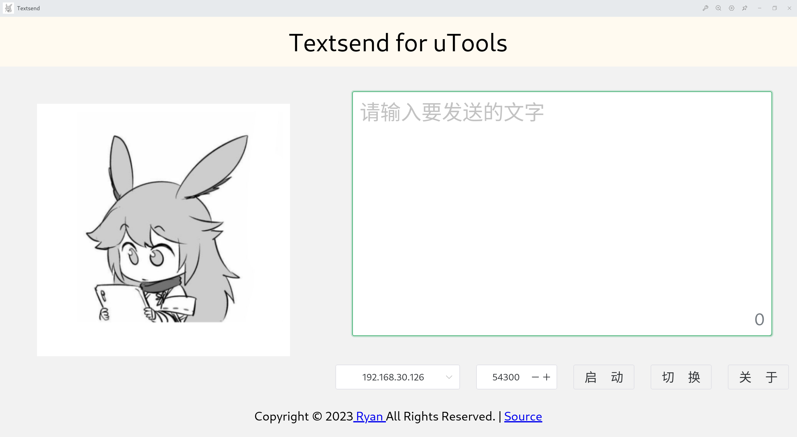
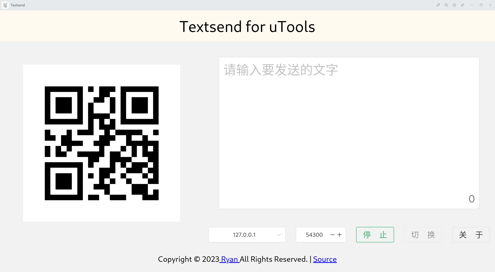
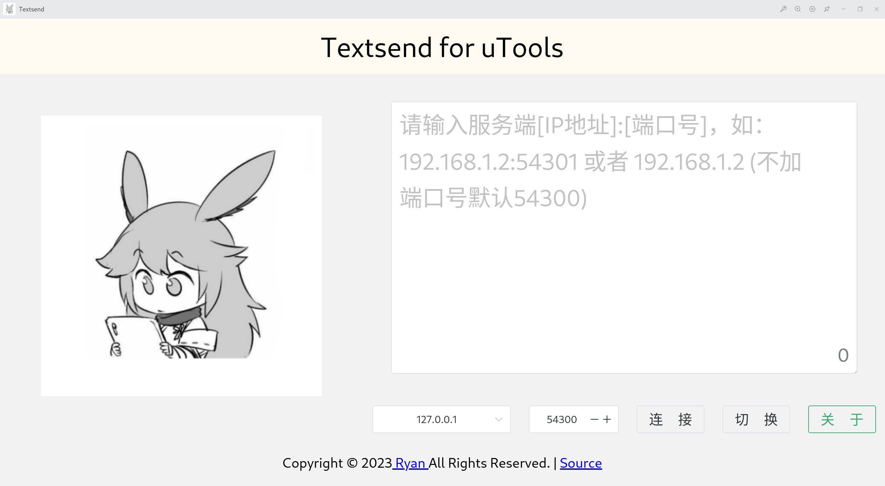

# TextSend_Utools_Plugin

本插件使用 **Vue3 + Pinia + Nodejs** 书写  |  当前版本：5.0.8

## 支持的平台

Windows / Linux ：

[Java Swing](https://github.com/rmshadows/TextSend_Desktop) | [uTools Plugin](https://github.com/rmshadows/TextSend_Utool)

安卓：

[Android](https://github.com/rmshadows/TextSend_Android)      | [演示视频](https://www.bilibili.com/video/BV1j3411q7gQ/)

## 起因

我不是专业从业者，有一天朋友突然说他在使用uTools，我想着既然Textsend已经有桌面端(基于Java Swing)、移动端(Android)了，不妨再加个插件。我个人比较常用的语言是Java和Python，因为他们容易跨平台，我主力系统是Debian GNU/Linux，身边朋友几乎都是Windows系统，所以选择了容易跨平台的语言。uTools文档我稍微翻了翻，对于我这种完全没接触过Javascript、Nodejs、Vuejs的非专业从业人员来说还是有点难。不过好在开发门槛低，我边查边写，也算是写好了，Vuejs部份的代码感谢[許景欣](https://github.com/xjx0106)的贡献。

## 关于维护

很抱歉，可能做不到维护，通过这次书写，我很深刻认识到专业与非专业的差距，所以新功能应该是很难加了，不过大家还是可以讨论。

```
局域网内的文字传输工具，会将文字直接粘贴到接收端，实现一个设备打字到另一个设备。目前有安卓端、uTools端、PC桌面端（Java Swing，支持跨平台）

Github：
uTools插件地址：https://github.com/rmshadows/TextSend_Utool
PC端：https://github.com/rmshadows/TextSend_Desktop
Android端：https://github.com/rmshadows/TextSend_Android

演示视频：
【TextSend-3.1.2-使用演示-2021年9月9日】 https://www.bilibili.com/video/BV1j3411q7gQ/?share_source=copy_web&vd_source=2f0a1572fbd3048a5eb5a17f09da604d

关于审核“启动后，其他设备无法打开此地址”的回复：
Textsend占用54300端口后（可更改端口号），其他应用自然无法再使用54300端口。同时，Textsend监听的54300端口，只能接收Textsend客户端的连接，其他应用连接匹配不上的会自动断开（防止占用），就像是在80端口开了HTTP服务，用SSH连接当然连不上一个道理。此uTools插件可以多开，通过127.0.0.1:54300连接。或者同个局域网中（本来就是设计为局域网工具），用其他Textsend客户端（安卓端或Java端）连接可连接上（防火墙要开放端口，插件开发仅在Linux做过测试，本人非专业开发人员，设备条件有限，物理机没有装Windows系统，但是朋友说在Windows系统也可以使用『嘻嘻，这个插件本来就是写给使用uTools的朋友用的』）。
```

## 目录结构

- `buildVueforuTools.sh`——一键导出Vue项目到UI文件夹供utools直接使用
- `index.html`——首页
- `LICENSE`——GPLv3
- `logo.png`——项目图标
- `package.json`——项目依赖
- `plugin.json`——utools插件集成
- `public`——公共资源
- `README.md`——本文件
- `src`——源代码
  - `App.vue`
  - `assets`
  - `components`——Vue组件
  - `js`——Vue组件的部份Js，比如和utools API交互的
  - `main.js`
  - `nodejs`——Nodejs模块
    - client1.js——测使用的Client
    - client.js——客户端组件
    - crypto.js——加密组件
    - hashcode.js——hashcode组件，用于分配客户端ID
    - maes——AES加密模块 https://github.com/rmshadows/RM_Libs
    - message.js——负责消息加密（解密是接收端的事情）
    - mqrcode——二维码模块 https://github.com/rmshadows/RM_Libs
    - profile.js——配置文件（防止循环引用）
    - qrimg.js——给utools插件调用的二维码模块
    - server1.js——测试用的服务端
    - server.js——服务端组件
    - system.js——给utools插件调用的系统组件 获取IP
  - `stores`——Pinia
- `tspreload.js`——utools的preload
- `ui`——vuejs导出的文件，utools读取的静态资源
- `vite.config.js`——vue vite配置

## Project Setup

```sh
npm install
```

### Vue3 Compile and Hot-Reload for Development

```sh
npm run dev
```

注意：使用了uTools API的可能会报错（因为没有运行在uTools中）

### Compile for Production

使用`npm run build`后移动`dist`到`ui`文件夹

推荐直接使用脚本`buildVueforuTools.sh`

### uTools调试

这个请直接看官网[文档](https://www.u.tools/docs/developer/welcome.html#plugin-json)了

# 使用说明

> 局域网即时投送：**5.0.0** 起协议 v1 文字（`ts://` + PIN / 长密钥）；**5.0.8** 起可与 PC / 安卓互发文件。协议以仓库根目录 `README.md` 为准（不再走旧 Object / JSON 外壳）。

## 服务端模式

1. 选择本机局域网 IP 和端口，点击启动。会生成 **ts:// 长密钥二维码**，并显示 8 位 PIN。
2. 点 PIN：复制 `ts://IP:端口/kPIN`；右键 PIN：只复制 8 位数字。点二维码：复制长密钥连接串。
3. 左键启动只允许 1 个客户端；右键启动最多 7 个。PIN 旁显示已连接数。

## 客户端模式

1. 点「切换」到客户端。在输入框粘贴连接串。端口可省略，默认 54300，例如：

   ```
   ts://192.168.31.10/k38492017
   192.168.31.10/k38492017
   ts://192.168.31.10:54300/k38492017
   ```

2. 点连接。连上后输入框用来发文字。收到的字会复制并尝试粘贴到当前焦点。

## 文件

顶部「文件」「发送」「取消」。点「文件」多选扁文件（最多 50）；**按住 Shift 再点「文件」**选文件夹（不限个数，按相对路径重建）。也可把文件/文件夹拖进窗口。

- 对面落到系统「下载/TextSend」，不弹保存框。
- 本机收到的图片 ≤20MB 进剪贴板，更大或解码失败则落地。手机发来的图一律落地。
- 取消只停这一轮，待发还在。发送方取消对面留半截可续传；接收方取消才删半截。连续取消接收 3 次冷却 10 秒。
- 对端 HELLO 没有 `"file"` 会立刻失败（旧 uTools 5.0.7）。
- 修改 `tspreload.js` 或 `src/nodejs/` 或 `ui/` 后须重新载入插件；构建用 `npm run udev` 或 `npm run build`（会自动拷 `logo.png` → `dist/assets/favicon.png`）。

## 维护说明（5.0.8）

- **发文件**：2026-08-24 修稳（`writeFrameWait` 回压；取消 `cancelEpoch` + `_sendControlWait`）。用户实机：服务端→安卓可用。
- **二维码**：监听成功后再刷；快速启停用 `qrGen` 丢弃过期回调；未启动左侧显示打包的 `logo.png`。
- **可选 polish**（未做）：待发列表 UI 对齐 PC；文件夹打勾多选；`/tmp/tsqrcode-*.png` 定期清理。

# 更新日志

5.0.0 起为协议 v1（二进制帧 / AES-GCM / `ts://`），与旧 0.0.x JSON 协议不互通。

- 2026.8.24——5.0.8（续）
  - **修**：服务端发文件进度过早 / 取消无效（`writeFrameWait` + `cancelEpoch`）
  - **修**：未启动 logo 裂图；快速启停二维码不显示（`qrGen`、监听成功后再刷码）
  - 构建：`npm run build` 自动拷 favicon；`ui/` bundle 约 `index-56b0de77.js`

- 2026.8.23——5.0.8
  - 文件投送：顶部「文件 / 发送 / 取消」；待发列表；进度与速度
  - 落到「下载/TextSend」；图 ≤20MB 进剪贴板；续传（头/尾 SHA-256）
  - Shift+「文件」发文件夹；拖入文件/文件夹
  - HELLO `caps` 含 `"file"`，与 PC 5.0.53 / Android 5.0.10 对齐
  - UI：冷灰主题、帮助、IP 悬停、剪贴板图预览、单「发送」按钮

- 2026.8.20——5.0.7
  - 服务端显示已连接客户端数（右键启动为 n/7）

- 2026.8.20——5.0.6
  - 客户端连接串可省略端口，默认 54300

- 2026.8.20——5.0.5
  - 客户端连上后清空输入框（连接串和发文字共用同一框）

- 2026.8.20——5.0.4
  - 客户端连上后点「断开」会卡住：轮询停了却没把连接状态打回去

- 2026.8.20——5.0.3
  - Ctrl+Enter 发送（已连接时）

- 2026.8.20——5.0.2
  - IP 下拉：局域网在前，127 / fe80 / 169.254 在末尾

- 2026.8.20——5.0.1
  - 缩小默认排版；标题旁百分比滚轮缩放（记住）

- 2026.8.20——5.0.0
  - 对齐 TextSend 协议 v1：二进制帧、AES-GCM、PIN / 长密钥、`ts://` 二维码
  - 与 PC 5.0.30、Android 5.0.5 文字收发互通（旧 JSON 固定密钥协议已去掉）
  - 点 PIN / 二维码复制连接串；客户端输入框粘贴 `ts://`

- 2024.2.11——0.0.8
  - 没有什么大更新。
  - 更新README。
  - 更新描述。

- 2024.2.3——0.0.7
  - 适配了IPv6
  - 此版本更新与0.0.6版本不兼容。
  - 此版本更新与Textsend Desktop版本4.0.3以下不兼容。
  - 此版本更新与Textsend Android版本4.0.1以下不兼容。
- 2023.09.02——0.0.6
  - 没什么大的更新
- 2023.08.28——0.0.5
  - 解决了长文本传输的问题(但连续快速发送会出错，比如连续分别发送“A”、“B”，对方只会收到“AB”)
- 2023.08.26——0.0.4
  - 第一个正式版本
  - 优化了注释
- 2023.08.10——0.0.2d
  - 界面基本完成
  - /TODO：从`vuex`迁移到`pinia`
- 2022.06.26——0.0.1d
  - 初始化了一个没用的仓库
  - 修改项目`README.md`文件内容，表明这是一个废弃的项目

# 截屏







# 开发备忘录

> 协议以仓库根目录 `README.md` 为准。下面旧 Object / JSON 外壳说明已过时，仅作历史。

- **现行**：TCP 上二进制帧 `TS` + AES-256-GCM；HELLO `caps: ["text","file"]`；文字 TEXT+ACK；文件 `FILE_META/CHUNK/DONE/CONTROL`。
- Vue 仍轮询 preload（`getConnectionStat` / `getFileStat`），没有走 Electron IPC。


